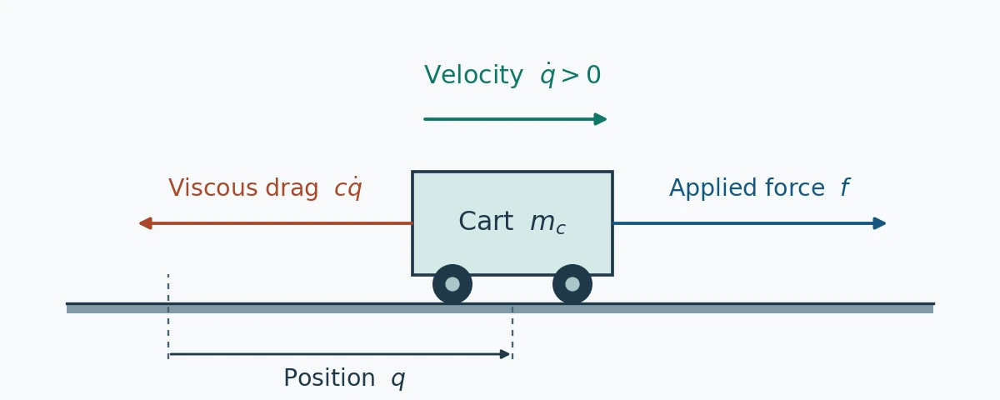
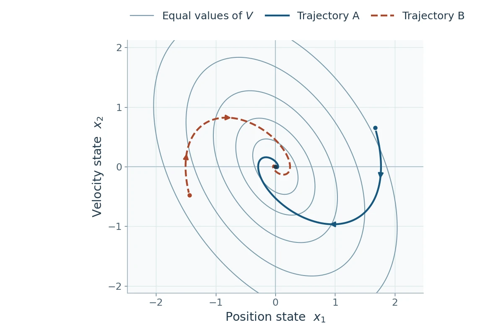
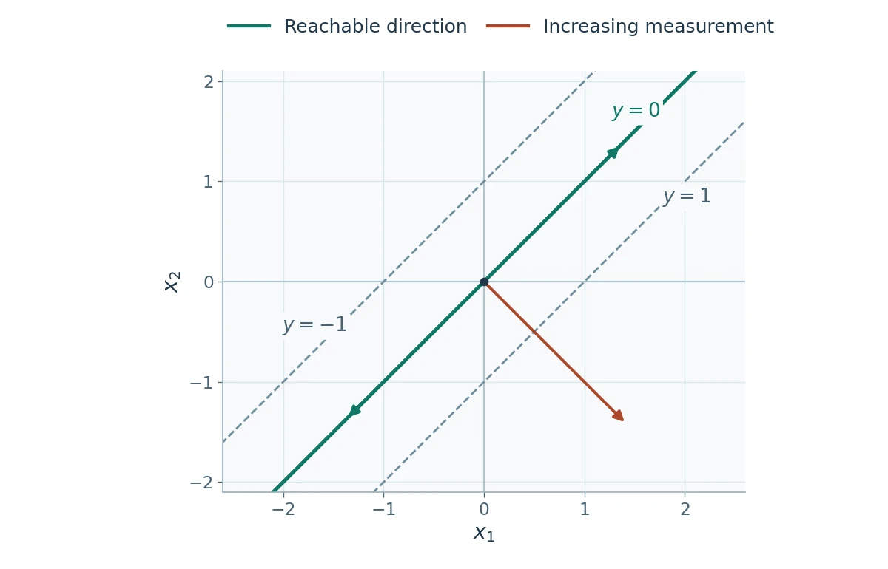
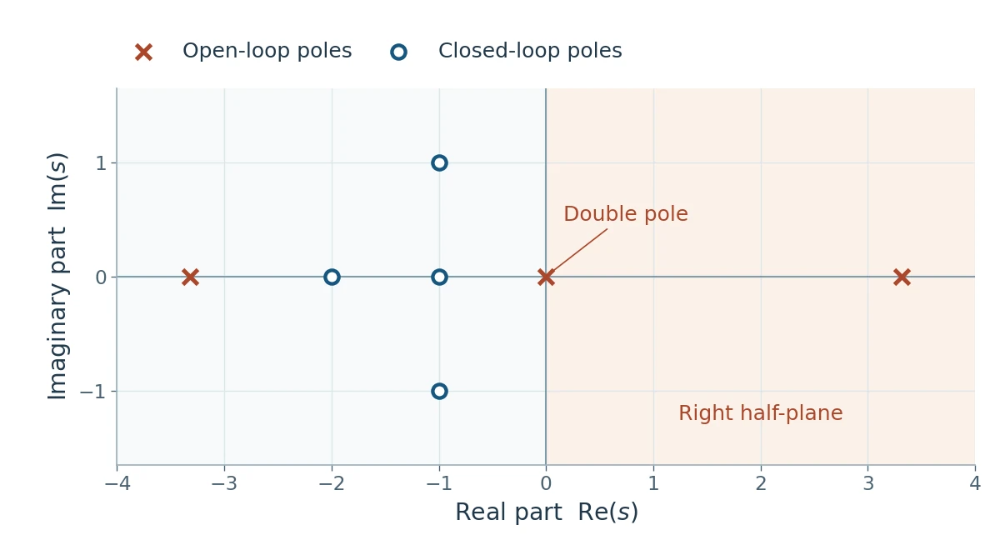
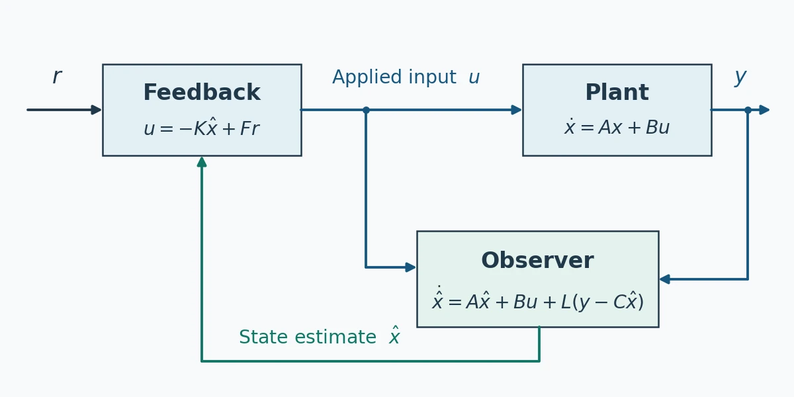
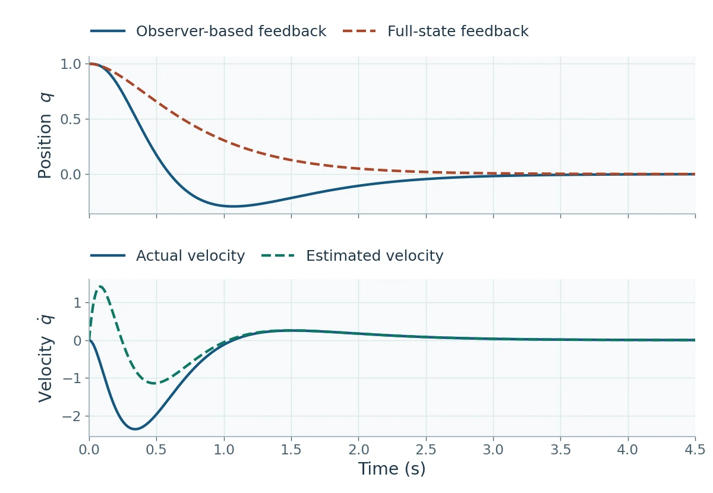
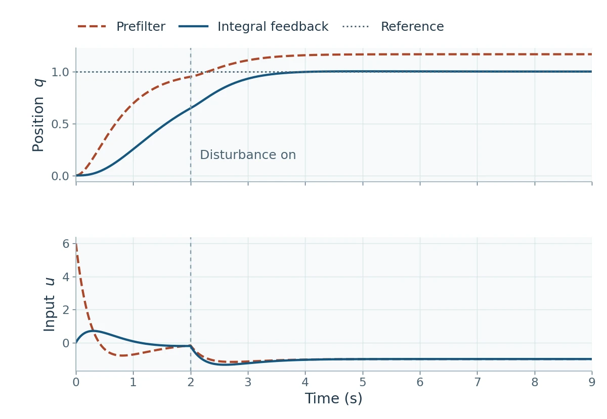
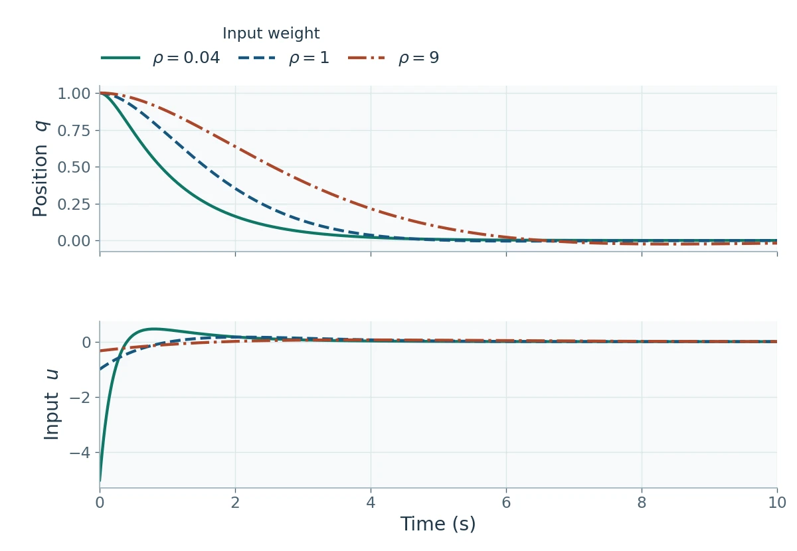
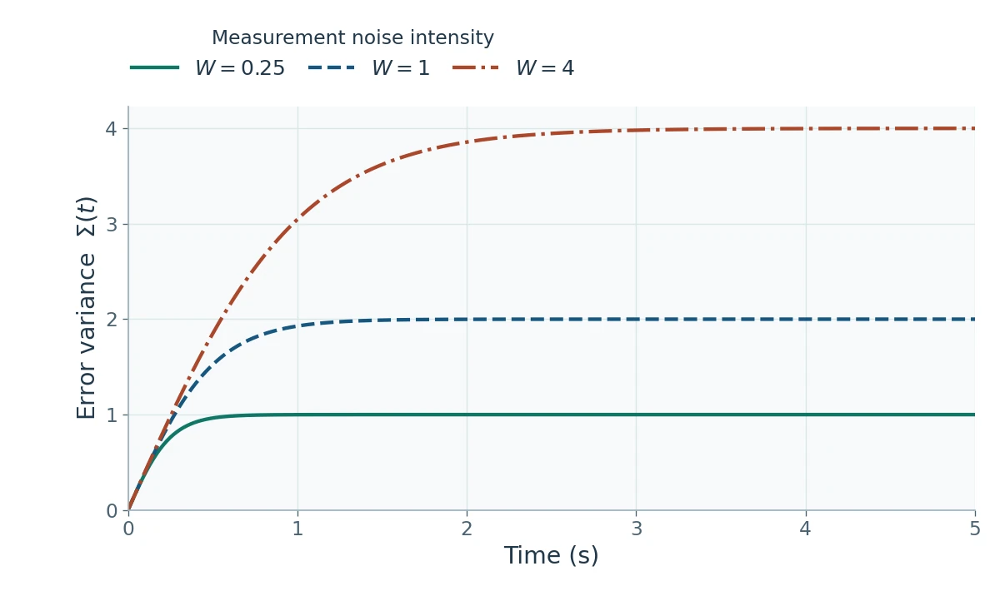

A cart can pass through the same position on its way left or right. A position sensor gives the same reading in both cases, yet the controller must apply a different force to stop the cart at its target. Position and velocity together describe what the cart will do next. That distinction between what a system **is doing** and what a sensor **can tell us** runs through modern control theory.

This note follows the continuous-time course from modeling through optimal control. A small cart model carries the calculations across chapters. A cart–pendulum adds an unstable mode and shows why the same design steps matter for a physical system. Basic matrix algebra, ordinary differential equations, and the Laplace transform are enough to follow the derivations.

## 1. Introduction and state-space models

### The feedback loop

The **plant** is the process we want to control. An actuator applies the manipulated input $u$, a sensor measures the output $y$, and the controller uses that measurement to select the next input. The reference $r$ specifies the desired value. A disturbance $d$ represents an influence outside the controller's command, such as an extra force on the cart or a change in the load. The measured output can differ from the quantity we actually want to regulate.

An open-loop controller computes its action from the command and the model. A closed-loop controller uses measurements to correct the action as the plant responds. For a single-input, single-output (SISO) loop with controller $G_c(s)$, plant $G_p(s)$, and sensor $H_s(s)$, the error is $r-H_s y$. The closed-loop reference-to-output transfer follows by solving $y=G_pG_c(r-H_s y)$.

$$
\frac{Y(s)}{R(s)}=
\frac{G_c(s)G_p(s)}{1+G_c(s)G_p(s)H_s(s)}.
$$

Feedback changes the characteristic dynamics through the denominator. For a disturbance added at the plant output, the transfer to $y$ is $1/(1+G_cG_pH_s)$. The usefulness of feedback therefore depends on frequency, loop stability, and actuator authority. The course's modeling–analysis–design sequence starts with requirements such as tracking error, settling time, and disturbance rejection. It then cycles through sensor and actuator selection, model development, controller design, and simulation or physical testing.

### States, inputs, and outputs

The **state** $x(t_0)$ is a set of variables sufficient to determine the future trajectory given the input for $t\ge t_0$. Its components are coordinates in state space. For a continuous-time, linear time-invariant (LTI) model with $n$ states, $m$ inputs, and $p$ outputs,

$$
\begin{aligned}
\dot x(t)&=Ax(t)+Bu(t), & x(t_0)&=x_0,\\
y(t)&=Cx(t)+Du(t),\\
A&\in\mathbb R^{n\times n}, & B&\in\mathbb R^{n\times m},\\
C&\in\mathbb R^{p\times n}, & D&\in\mathbb R^{p\times m}.
\end{aligned}
$$

$A$ describes internal dynamics, $B$ describes how the actuators affect the state, and $C$ selects combinations of states for the sensors. The direct-feedthrough matrix $D$ captures an instantaneous contribution of the input to the output. The same equations cover multi-input, multi-output (MIMO) plants. For a smooth nonlinear model $\dot X=f(X,U)$, $Y=g(X,U)$, choose an operating point with $f(X_e,U_e)=0$. For the deviations $x=X-X_e$, $u=U-U_e$, and $y=Y-g(X_e,U_e)$, the first-order model has $A=f_X$, $B=f_U$, $C=g_X$, and $D=g_U$, all evaluated at that point. Its accuracy is generally local.

For a cart of mass $m_c$ with viscous drag $c$, Newton's law gives $m_c\ddot q+c\dot q=f$. With normalized force $u=f/m_c$, drag rate $\gamma=c/m_c$, and measured position $y=q$, choose $x_1=q$ and $x_2=\dot q$.

$$
\dot x=
\begin{bmatrix}0&1\\0&-\gamma\end{bmatrix}x+
\begin{bmatrix}0\\1\end{bmatrix}u,
\qquad y=\begin{bmatrix}1&0\end{bmatrix}x.
$$

The first row records the definition of velocity. The second row records the force balance. Setting $\gamma=0$ gives the **double integrator** $\ddot q=u$, which will serve as the running example. The position sensor supplies one measurement of a two-dimensional state.

<figure>

<figcaption>The cart model uses position and velocity as states. The actuator sets the applied force, and the position sensor measures one component of the state.</figcaption>
</figure>

### From an ODE to a transfer function and back

Taking the Laplace transform at $t_0=0$ gives $(sI-A)X(s)=x_0+BU(s)$. The transfer matrix describes the response from $u$ to $y$ when $x_0=0$. With a nonzero initial state, the output includes the extra term $C(sI-A)^{-1}x_0$.

$$
G(s)=C(sI-A)^{-1}B+D.
$$

Every entry of a MIMO transfer matrix describes one input-to-output channel. The resolvent $(sI-A)^{-1}$ is shared across those channels. For the cart, direct calculation gives $G(s)=1/[s(s+\gamma)]$. For any ordinary finite-dimensional realization, the resolvent tends to zero at high frequency, so $G(s)$ is proper and $D=\lim_{s\to\infty}G(s)$. A strictly proper transfer has $D=0$.

For a scalar equation $y^{(n)}+a_1 y^{(n-1)}+\cdots+a_ny=u$, choose $x_i=y^{(i-1)}$. The first $n-1$ rows shift each derivative to the next state. The last row solves for $y^{(n)}$. The same companion matrix realizes a general proper SISO transfer $G(s)=b(s)/a(s)$ with $a(s)=s^n+a_1s^{n-1}+\cdots+a_n$ and $b(s)=b_0s^n+b_1s^{n-1}+\cdots+b_n$.

$$
\begin{aligned}
A_c&=\begin{bmatrix}
0_{(n-1)\times 1} & I_{n-1}\\
-a_n & -a_{n-1}\;\cdots\;-a_1
\end{bmatrix}, \qquad B_c=e_n,\qquad D_c=b_0,\\
C_c&=\begin{bmatrix}b_n-b_0a_n&\cdots&b_1-b_0a_1\end{bmatrix}.
\end{aligned}
$$

Here $e_i$ denotes the $i$th coordinate vector. To see why the construction works, solve $(sI-A_c)X=e_nU$. The first rows give $X_i=s^{i-1}X_1$, and the last gives $a(s)X_1=U$. The output row then builds $[b(s)-b_0a(s)]/a(s)$, and the direct term restores $b_0$. Derivatives of the input in the original scalar ODE are encoded by the output row and feedthrough. The realized state can therefore be propagated using $u$ alone.

For the lecture example $y^{(3)}+6\ddot y+11\dot y+6y=8\ddot u+17\dot u+8u$, the auxiliary state $x_1$ solves $x_1^{(3)}+6\ddot x_1+11\dot x_1+6x_1=u$. Its next two coordinates are $x_2=\dot x_1$ and $x_3=\ddot x_1$. The output $y=8x_1+17x_2+8x_3$ gives the desired numerator. This construction also makes the denominator roots $-1,-2,-3$ easy to recognize.

### Coordinate changes and modal form

An invertible coordinate change $x=Tz$ preserves the trajectory in the sense that $x(t)=Tz(t)$ for matching initial conditions and inputs. The matrices transform as

$$
\bar A=T^{-1}AT,\qquad \bar B=T^{-1}B,\qquad
\bar C=CT,\qquad \bar D=D.
$$

The identity $sI-\bar A=T^{-1}(sI-A)T$ gives the same characteristic polynomial and transfer matrix. Coordinates can expose useful structure. If $A$ has a basis of eigenvectors $v_i$, putting them in the columns of $T$ makes $\bar A$ diagonal. With real coordinates, a conjugate pair can instead be represented by a real two-dimensional block. When a repeated eigenvalue has too few eigenvectors, generalized eigenvectors extend a chain through $(A-\lambda I)v_{k+1}=v_k$. A chain yields a Jordan block $J_\lambda=\lambda I+N_J$ with ones on the superdiagonal of $N_J$. A repeated eigenvalue with a full eigenbasis needs only size-one blocks.

## 2. State trajectories and stability

### The matrix exponential

For $\dot x=Ax$, the state transition over an interval of length $t$ is $\Phi(t)=e^{At}$, defined by the convergent series $\sum_{k=0}^\infty A^k t^k/k!$. Differentiating this series gives $\dot\Phi=A\Phi$, with $\Phi(0)=I$. Transitions compose as $\Phi(t+s)=\Phi(t)\Phi(s)$ and invert as $\Phi(t)^{-1}=\Phi(-t)$. For a forced system, differentiate $e^{-At}x(t)$ and integrate from $t_0$ to $t$. This yields the initial-condition and input contributions together.

$$
x(t)=e^{A(t-t_0)}x_0+
\int_{t_0}^{t} e^{A(t-\tau)}Bu(\tau)\,d\tau.
$$

The first term is the **free response**. The second is the **forced response**. At $t_0=0$, an impulse $u=k\delta(t)$ jumps the state by $Bk$, so $x(t)=e^{At}(x(0^-)+Bk)$ for $t>0$. For a step $u=k$ and a ramp $u=kt$, the respective forced terms, when $A$ is invertible, are

$$
\begin{aligned}
x_{\mathrm{step}}(t)&=A^{-1}(e^{At}-I)Bk,\\
x_{\mathrm{ramp}}(t)&=
\bigl[A^{-2}(e^{At}-I)-tA^{-1}\bigr]Bk.
\end{aligned}
$$

The convolution integral also works when $A$ is singular. For the double integrator, $A^2=0$ gives $e^{At}=I+tA$. A unit step from rest therefore gives $q(t)=t^2/2$ and $\dot q(t)=t$.

For low-order examples, $e^{At}$ can be found by inverting the Laplace transform of $(sI-A)^{-1}$ or by using $A=TJT^{-1}$ and computing $Te^{Jt}T^{-1}$. The Cayley–Hamilton theorem gives $a(A)=0$ for $a(s)=\det(sI-A)$, so the exponential can also be represented by a polynomial in $A$ of degree below $n$. On a Jordan block of size $k$, the nilpotent part satisfies $N_J^k=0$ and the exponential has the form

$$
e^{J_\lambda t}=e^{\lambda t}\sum_{j=0}^{k-1}\frac{t^jN_J^j}{j!}.
$$

For example, take $A=\begin{bmatrix}0&1\\-2&-3\end{bmatrix}$. Its eigenvectors $(1,-1)^\top$ and $(1,-2)^\top$ correspond to $-1$ and $-2$. Multiplying out the diagonal exponential gives

$$
e^{At}=\begin{bmatrix}
2e^{-t}-e^{-2t}&e^{-t}-e^{-2t}\\
-2e^{-t}+2e^{-2t}&-e^{-t}+2e^{-2t}
\end{bmatrix}.
$$

With $B=(0,1)^\top$, $C=(1,0)$, and zero initial state, integrate the second column for a unit step. The output is $q(t)=\tfrac12(1-e^{-t})^2$. Its limit is $1/2$, which agrees with the equilibrium $-Ax_e=B$ and the DC gain $G(0)=1/2$.

### Internal stability and the role of poles

An equilibrium of an autonomous system $\dot x=f(x)$ satisfies $f(x_e)=0$. After shifting the equilibrium to the origin, **Lyapunov stability** means that for every $\varepsilon>0$ some $\delta>0$ ensures $\|x(t)\|<\varepsilon$ for all $t\ge0$ whenever $\|x(0)\|<\delta$. **Asymptotic stability** adds convergence to the origin from a neighborhood. **Global asymptotic stability** requires attraction from every initial state.

For an LTI system, the eigenvalues of $e^{At}$ are $e^{\lambda_i t}$. The Jordan-block formula explains the complete stability test.

- If every $\operatorname{Re}\lambda_i<0$, $A$ is **Hurwitz**. Every free trajectory decays exponentially, including those with polynomial factors from Jordan blocks.
- If every $\operatorname{Re}\lambda_i\le0$ and the imaginary-axis eigenvalues are semisimple, all trajectories stay bounded. The presence of an imaginary-axis eigenvalue makes the system marginally stable, with at least one persistent mode.
- A positive real part or an imaginary-axis Jordan block of size greater than one makes the origin unstable. The double integrator has a size-two block at zero, which produces the drift $q(t)=q(0)+t\dot q(0)$.

For $A=\operatorname{diag}(-1,0)$, the first state decays and the second stays at its initial value. The system as a whole is marginally stable. **Bounded-input, bounded-output (BIBO) stability** concerns the zero-initial-state input–output map. For a proper rational continuous-time transfer, all its poles after cancellation must lie in the open left half-plane. An internal mode can be missing from that map, which is why minimality will matter in Section 3. [MIT notes on input–output stability](https://ocw.mit.edu/courses/6-241j-dynamic-systems-and-control-spring-2011/resources/mit6_241js11_lec12/)

### Lyapunov's indirect and direct methods

The **indirect method** applies the eigenvalue test to the Jacobian $A=f_x(x_e)$ of a smooth nonlinear system. A Hurwitz Jacobian gives local exponential stability. An eigenvalue with positive real part gives instability. In the remaining case, with one or more imaginary-axis eigenvalues and none in the open right half-plane, the higher-order terms decide the result. For instance, the scalar systems $\dot x=-x^3$ and $\dot x=x^3$ have the same linearization at zero and different stability.

The **direct method** starts from a differentiable scalar function $V(x)$ with $V(0)=0$ and $V(x)>0$ near the origin for $x\ne0$. Along trajectories its rate is $\dot V=\nabla V^\top f(x)$. A nonpositive rate gives stability. A strictly negative rate away from the origin gives asymptotic stability, while a strictly positive rate in a punctured neighborhood gives instability. If the decay conditions hold globally and $V$ is radially unbounded, the conclusion is global. Sublevel sets of a radially unbounded $V$ are compact, which keeps trajectories in a bounded region as $V$ decreases.

For the nonlinear lecture example $\dot x_1=-x_1^3-4x_2$, $\dot x_2=3x_1-7x_2$, take $V=3x_1^2+4x_2^2$. The coefficients cancel the mixed terms, leaving $\dot V=-6x_1^4-56x_2^2$. This proves global asymptotic stability. When $\dot V\le0$ holds with equality on a larger set, **LaSalle's invariance principle** gives attraction to the largest invariant subset of $\{\dot V=0\}$ within a compact positively invariant region. For $\dot x_1=x_2$, $\dot x_2=-x_1-x_2$, the choice $V=x_1^2+x_2^2$ gives $\dot V=-2x_2^2$. A trajectory that stays on $x_2=0$ must also satisfy $\dot x_2=-x_1=0$. Hence the largest invariant subset is the origin.

Local certificates also estimate a **region of attraction**, the set of initial conditions whose trajectories converge to the equilibrium. For the lecture system $\dot x_1=-x_1^3+x_2^4$, $\dot x_2=-x_2^3+x_1^4$, choose $V=(x_1^2+x_2^2)/2$. Its derivative is

$$
\dot V=-(1-x_2)x_1^4-(1-x_1)x_2^4.
$$

The derivative is strictly negative away from zero wherever both $x_1<1$ and $x_2<1$. Every sublevel set $V\le c$ with $0<c<1/2$ lies inside that region and is positively invariant. Those disks give a conservative estimate. In general, look for a compact sublevel set lying inside the region where the derivative test holds. [MIT notes on internal Lyapunov stability](https://ocw.mit.edu/courses/6-241j-dynamic-systems-and-control-spring-2011/resources/mit6_241js11_chap13/)

### Worked example with the Lyapunov equation

For $\dot x=Ax$, a quadratic candidate $V=x^\top Px$ with $P=P^\top\succ0$ gives $\dot V=x^\top(A^\top P+PA)x$. Here $\succ0$ denotes positive definiteness of the quadratic form, and $\succeq0$ permits equality away from the origin. A matrix $A$ is Hurwitz exactly when for each $Q=Q^\top\succ0$ the Lyapunov equation has a unique symmetric positive-definite solution.

$$
A^\top P+PA=-Q,\qquad
P=\int_0^\infty e^{A^\top t}Qe^{At}\,dt
\quad\text{when }A\text{ is Hurwitz}.
$$

The integral is the accumulated quadratic state cost along a free trajectory. Differentiating the integrand shows why the equation produces $-Q$ at the lower endpoint. Conversely, a positive-definite solution gives $\dot V=-x^\top Qx<0$ for every nonzero state, proving asymptotic stability.

With $A=\begin{bmatrix}-1&2\\0&-3\end{bmatrix}$ and $Q=I$, write the independent entries of $P$ as $p_{11},p_{12},p_{22}$. The equations are $-2p_{11}=-1$, $2p_{11}-4p_{12}=0$, and $4p_{12}-6p_{22}=-1$. Thus $P=\begin{bmatrix}1/2&1/4\\1/4&1/3\end{bmatrix}$, with positive leading entry and determinant $5/48$. For the oscillator above, solving the same equation gives $V=\tfrac32x_1^2+x_1x_2+x_2^2$. Its level sets make the decrease of $V$ visible even when individual state components temporarily grow.

<figure>

<figcaption>The damped oscillator crosses successively lower levels of the quadratic Lyapunov function. The arrows follow the direction of increasing time.</figcaption>
</figure>

## 3. Controllability, observability, and realization

### What the actuator can reach

A system is **reachable** if every target state can be reached from zero in finite time. **Controllability to the origin** starts from an arbitrary state and asks whether an input can take it to zero. For continuous-time LTI systems with unconstrained inputs, these conditions and the ability to connect any two states are equivalent. Over any $T>0$, the input must supply the difference $\Delta=x_f-e^{AT}x_0$, and the transition matrix $e^{AT}$ is invertible.

The reachable subspace is the column space of the **controllability matrix** $\mathcal C$. The first block gives the directions in which the input acts immediately. Multiplication by $A$ propagates those directions through the dynamics, and Cayley–Hamilton ensures that higher powers add no new directions.

$$
\mathcal C=\begin{bmatrix}B&AB&\cdots&A^{n-1}B\end{bmatrix},
\qquad
(A,B)\text{ controllable}\iff \operatorname{rank}\mathcal C=n.
$$

The finite-horizon controllability Gramian is $W_c(T)=\int_0^T e^{At}BB^\top e^{A^\top t}\,dt$. Full controllability is equivalent to $W_c(T)\succ0$ for every $T>0$. Indeed, a vector $v$ lies in its kernel exactly when $B^\top e^{A^\top t}v$ vanishes throughout the interval, or equivalently when $v$ is orthogonal to all columns of $\mathcal C$. When $W_c$ is invertible, the least-energy transfer that minimizes $\int_0^T u^\top u\,dt$ is

$$
u_\star(t)=B^\top e^{A^\top(T-t)}W_c(T)^{-1}\Delta.
$$

Substituting this input into the convolution gives the required endpoint. It is orthogonal in the integral inner product to every input that produces zero endpoint change, which proves that it has the least energy. Rank is an exact algebraic test. The Gramian also shows why a mathematically reachable direction can demand large effort when its Gramian eigenvalue is small in the chosen coordinates.

For the double integrator, $e^{At}B=(t,1)^\top$. Integrating its outer product gives $W_c(T)=\begin{bmatrix}T^3/3&T^2/2\\T^2/2&T\end{bmatrix}$. A move from rest at zero to rest at unit position has $\Delta=(1,0)^\top$. The least-energy input is $u_\star(t)=6/T^2-12t/T^3$. It accelerates the cart for the first half of the move and brakes it for the second half, giving both $q(T)=1$ and $\dot q(T)=0$.

### What the sensors can infer

**Observability** asks whether the initial state can be determined from a finite record of the output and the known input. Subtract the known forced response and the term $Du$ from $y$. The residual is $y_{\mathrm{free}}(t)=Ce^{At}x_0$. Its first $n$ derivatives, counting the value at $t=0$ as order zero, give the rows of the observability matrix applied to $x_0$.

$$
\mathcal O=\begin{bmatrix} C\\CA\\ \vdots\\ CA^{n-1}\end{bmatrix},
\qquad
(A,C)\text{ observable}\iff \operatorname{rank}\mathcal O=n.
$$

The unobservable subspace $\ker\mathcal O$ consists of state differences that produce identical outputs for every common input. Equivalently, $W_o(T)=\int_0^T e^{A^\top t}C^\top Ce^{At}\,dt$ is positive definite exactly when the model is observable. In that case, multiply $y_{\mathrm{free}}(t)$ by $e^{A^\top t}C^\top$, integrate, and solve the resulting linear equation $W_o(T)x_0=\int_0^T e^{A^\top t}C^\top y_{\mathrm{free}}(t)\,dt$.

The **Popov–Belevitch–Hautus (PBH) tests** identify the eigenvalues at which reachability or observability fails. For each eigenvalue $\lambda$ of $A$, the two tests are

$$
\begin{aligned}
\operatorname{rank}\begin{bmatrix}\lambda I-A&B\end{bmatrix}&=n,\\
\operatorname{rank}\begin{bmatrix}\lambda I-A\\ C\end{bmatrix}&=n.
\end{aligned}
$$

The first fails when a nonzero left eigenvector annihilates $B$. The second fails when a nonzero right eigenvector lies in $\ker C$. Transposition exchanges these statements. The dual realization $(A^\top,C^\top,B^\top,D^\top)$ has transfer $G(s)^\top$, and its controllability matrix is $\mathcal O^\top$ of the original. A pair $(A,B)$ is **stabilizable** if the first PBH test holds for every $\lambda$ with $\operatorname{Re}\lambda\ge0$. A pair $(A,C)$ is **detectable** if the second test holds there. These weaker properties allow hidden modes that already decay. [MIT notes on reachability and observability](https://ocw.mit.edu/courses/6-241j-dynamic-systems-and-control-spring-2011/resources/mit6_241js11_lec20/)

### Worked example with hidden directions

Combine two sensor and actuator configurations from the lecture using $A=\begin{bmatrix}-2&1\\1&-2\end{bmatrix}$, $B=(1,1)^\top$, and $C=(1,-1)$. In physical coordinates the input enters both state equations, but $AB=-B$ and $CA=-3C$. Both rank tests give rank one. Set $z_+=(x_1+x_2)/2$ and $z_-=(x_1-x_2)/2$. The model becomes

$$
\dot z_+=-z_++u,\qquad
\dot z_-=-3z_-,\qquad y=2z_-.
$$

The input moves the common mode $z_+$, and the sensor reads the difference mode $z_-$. PBH detects an uncontrollable eigenvalue at $-3$ and an unobservable eigenvalue at $-1$. Both are stable. For the running cart, $B=(0,1)^\top$, $AB=(1,0)^\top$, $C=(1,0)$, and $CA=(0,1)$, so both tests give full rank. Actuating acceleration can change both position and velocity. Likewise, the evolution of the measured position contains information about velocity.

<figure>

<figcaption>In the two-state example, changing the input moves the state along the common-mode direction. The sensor reports the difference between the two coordinates.</figcaption>
</figure>

### Structural decompositions and minimal models

Both $\operatorname{im}\mathcal C$ and $\ker\mathcal O$ are invariant under $A$. For the reachability decomposition, choose the first columns of $T$ as a basis of $\operatorname{im}\mathcal C$ and complete the basis. For the observability decomposition, choose the first rows of $T^{-1}$ as a basis of the row space of $\mathcal O$ and complete the rows. With the reachable or observable coordinates listed first, the respective forms are

$$
\begin{aligned}
A_{\mathrm r}&=\begin{bmatrix}A_r&A_{12}\\0&A_{\bar r}\end{bmatrix},
& B_{\mathrm r}&=\begin{bmatrix}B_r\\0\end{bmatrix},\\
C_{\mathrm r}&=\begin{bmatrix}C_r&C_{\bar r}\end{bmatrix},\\[3pt]
A_{\mathrm o}&=\begin{bmatrix}A_o&0\\A_{21}&A_{\bar o}\end{bmatrix},
& B_{\mathrm o}&=\begin{bmatrix}B_o\\B_{\bar o}\end{bmatrix},\\
C_{\mathrm o}&=\begin{bmatrix}C_o&0\end{bmatrix}.
\end{aligned}
$$

The unreachable state evolves autonomously. The unobservable state cannot affect the observable state or the output. The combined Kalman decomposition exposes the reachable/observable part along with three other parts corresponding to the other combinations of those properties. Only the reachable and observable part contributes to the zero-initial-state transfer. A realization is **minimal** exactly when it is both controllable and observable. All minimal realizations of a given transfer matrix are related by similarity. For SISO systems the minimal dimension is the denominator degree after cancellation. For MIMO systems, dimension also depends on how many independent state directions realize the channels at each pole. [MIT lecture on minimal realizations](https://ocw.mit.edu/courses/6-241j-dynamic-systems-and-control-spring-2011/resources/mit6_241js11_lec21/)

In the lecture's three-state example, $A=\operatorname{diag}(-1,-2,-3)$, $B=(1,0,1)^\top$, and $C=(0,1,1)$. The first state responds to the input but stays hidden from the output. The second is visible through its free response but receives no input. The third is both reachable and observable, and $G(s)=1/(s+3)$. Its one-state realization is $\dot z=-3z+u$, $y=z$. Replacing the first diagonal entry of $A$ by $+1$ would leave that transfer unchanged and introduce an unstable internal mode.

### Controllable and observable companion forms

The SISO companion realization in Section 1 is always controllable. Its transpose dual $(A_c^\top,C_c^\top,B_c^\top,D_c)$ is always observable and realizes the same scalar transfer. These forms also give a coordinate transformation for existing models. With a controllable single-input pair, define $p^\top=e_n^\top\mathcal C^{-1}$ and use the rows $p^\top,p^\top A,\ldots,p^\top A^{n-1}$ for $T^{-1}$. The resulting $\bar B$ is $e_n$, and Cayley–Hamilton gives the companion last row of $\bar A$. With an observable single-output pair, set $v=\mathcal O^{-1}e_n$ and take $T=[v,Av,\ldots,A^{n-1}v]$. This produces the transpose companion dynamics and $\bar C=e_n^\top$.

Proper rational transfer functions have ordinary finite-dimensional realizations. A scalar strictly proper transfer with distinct simple poles $\lambda_i$ also admits a modal realization. If $G(s)=\sum_i \rho_i/(s-\lambda_i)$, take $A=\operatorname{diag}(\lambda_i)$, $B$ as a column of ones, and $C=[\rho_1,\ldots,\rho_n]$, combining conjugate modes into real blocks when needed. Companion coordinates use polynomial coefficients directly, while modal coordinates make each term of the partial-fraction expansion visible.

## 4. State feedback and pole placement

### What feedback can change

Assume $D=0$ for the following feedback designs. With full state access, the law $u=-Kx+Fr$ gives

$$
\begin{aligned}
\dot x&=(A-BK)x+BFr,\qquad y=Cx,\\
G_{r\to y}(s)&=C\bigl(sI-(A-BK)\bigr)^{-1}BF.
\end{aligned}
$$

Static output feedback $u=-Hy+Fr$ has the same form with $K=HC$. Its available gains are restricted to those that can be factored through the measured output. Both laws preserve the number of internal states. With the original input channel $B$ available, replacing $A$ by $A-BK$ also preserves the reachable subspace. For example, $(A-BK)B=AB-B(KB)$, so the second block of the controllability matrix changes by a combination of the first. The same triangular relation holds at every power.

Full state feedback can change observability through the original $C$. For the double integrator, if the only sensor reads velocity, the open-loop position is hidden. With $u=-k_1q-k_2\dot q+v$, the velocity derivative contains $-k_1q$, and the system from $v$ to the measured velocity is observable whenever $k_1\ne0$. Static output feedback preserves the unobservable subspace as well as the reachable one when the original input channel is kept. To see the observability result, apply the reachability argument to the dual pair $(A^\top,C^\top)$ and the update $A^\top-C^\top H^\top B^\top$.

A subspace $\mathcal V$ is **controlled invariant** if some $K$ satisfies $(A-BK)\mathcal V\subseteq\mathcal V$. Equivalently, $A\mathcal V\subseteq\mathcal V+\operatorname{im}B$. The input can cancel the component of the dynamics that would take a state out of $\mathcal V$. To construct such a gain, choose a canceling input for each basis vector of $\mathcal V$ and extend that linear map to the whole state space. The reachable subspace is already invariant under every state feedback because it is $A$-invariant and contains $\operatorname{im}B$.

With an independent input $v$ in $u=-Kx+v$, state feedback preserves the invariant zeros. The Rosenbrock matrix $\mathcal R(s)$ of the original system and the one after feedback differ by multiplication on the right by an invertible matrix.

$$
\mathcal R_K(s)=
\begin{bmatrix}sI-A&-B\\ C&0\end{bmatrix}
\begin{bmatrix}I&0\\-K&I\end{bmatrix}.
$$

The values of $s$ where the rank drops below its generic value are therefore preserved. In a SISO transfer, the visible numerator can still change if a zero cancels a closed-loop pole. Check the full spectrum of $A-BK$ when certifying internal stability.

### Choosing poles and computing the gain

Arbitrary assignment of the $n$ eigenvalues of $A-BK$ is possible exactly when $(A,B)$ is controllable. Real gains require complex target poles to occur in conjugate pairs. If only $r$ directions are reachable, the $n-r$ eigenvalues of the unreachable block stay fixed, and only the reachable block can be assigned. Stabilization by state feedback is therefore possible exactly when the plant is stabilizable. [Stanford EE363 lecture on pole placement](https://ee363.stanford.edu/lectures/014_pole_placement.pdf)

For a single input, match $\det(sI-A+BK)$ to the desired polynomial $p_d(s)=\prod_i(s-\mu_i)$. In controllable companion coordinates, the gain is the difference between the desired and original coefficients ordered from constant term upward. Map it back with $K=\bar K T^{-1}$. Substituting the coordinate transformation from Section 3 gives **Ackermann's formula** for a controllable single-input pair.

$$
K=e_n^\top\mathcal C^{-1}p_d(A).
$$

This formula makes the algebra transparent for small systems. For numerical work on larger models, use a pole-assignment routine and verify the returned eigenvalues. For a dominant underdamped second-order pair, write the poles as $-\zeta\omega_n\pm j\omega_n\sqrt{1-\zeta^2}$. In the standard second-order step response with unit DC gain and no zeros, the overshoot fraction and peak time are

$$
M_p=e^{-\pi\zeta/\sqrt{1-\zeta^2}},\qquad
t_p=\frac{\pi}{\omega_n\sqrt{1-\zeta^2}}.
$$

For a higher-order system these expressions give starting values for pole selection. Extra poles and zeros can reshape the transient, so evaluate the actual output. Faster poles can increase the peak input and amplify the effect of unmodeled actuator or plant dynamics.

For the double integrator, $K=[k_1,k_2]$ gives $p_K(s)=s^2+k_2s+k_1$. Choosing poles at $-2$ and $-3$ gives $K=[6,5]$. Position-only static feedback has $k_2=0$ and contributes no velocity damping. A positive position gain gives an undamped oscillator, while a negative gain gives one positive eigenvalue. The angular-position-only balancing example in the lecture has the same missing damping term, although its upright open-loop stiffness is destabilizing.

### Worked example with an inverted pendulum

Let a cart of mass $M$ move horizontally under force $u$ and carry a pendulum of mass $m$, center-of-mass distance $\ell$, and moment of inertia $I_p$ about its center of mass. Use cart displacement $q$ and angle $\theta$ measured from the upright vertical, positive toward the right. Near $\theta=0$, the linear force and moment equations are

$$
\begin{aligned}
(M+m)\ddot q+m\ell\ddot\theta&=u,\\
(I_p+m\ell^2)\ddot\theta+m\ell\ddot q&=mg\ell\theta.
\end{aligned}
$$

They follow from the small-angle approximations $\sin\theta\simeq\theta$, $\cos\theta\simeq1$ and neglecting terms quadratic in the deviations. A normalized point-mass example with $M=1$, $m=0.1$, $\ell=1$, $I_p=0$, and $g=10$ gives $\ddot q=u-\theta$ and $\ddot\theta=11\theta-u$. With $x=(q,\dot q,\theta,\dot\theta)^\top$,

$$
A=\begin{bmatrix}
0&1&0&0\\0&0&-1&0\\0&0&0&1\\0&0&11&0
\end{bmatrix},
\qquad B=\begin{bmatrix}0\\1\\0\\-1\end{bmatrix}.
$$

The open-loop characteristic polynomial is $s^2(s^2-11)$, which includes the unstable upright mode. The controllability columns are $B$, $(1,0,-1,0)^\top$, $(0,1,0,-11)^\top$, and $(1,0,-11,0)^\top$. They span all four dimensions. For $K=[k_1,k_2,k_3,k_4]$, the closed-loop characteristic polynomial is

$$
\begin{aligned}
p_K(s)&=s^4+(k_2-k_4)s^3+(k_1-k_3-11)s^2\\
&\quad -10k_2s-10k_1.
\end{aligned}
$$

The targets $-1,-2,-1\pm j$ give $p_d=s^4+5s^3+10s^2+10s+4$, so coefficient matching yields $K=[-0.4,-1,-21.4,-6]$. This stabilizes the linearized plant near the upright position. It is a local balancing design, and its useful range depends on the nonlinear motion, cart travel, and available force.

<figure>

<figcaption>The upright cart–pendulum has a positive open-loop pole and a double pole at zero. The computed state feedback places all four poles in the open left half-plane.</figcaption>
</figure>

### Regulation, reference tracking, and decoupling

The feedback $u=-Kx$ regulates the state to zero when $A-BK$ is Hurwitz. To follow a constant command, solve the nominal equilibrium equations $Ax_e+Bu_e=0$ and $Cx_e=r$, then apply $u=u_e-K(x-x_e)$. Equivalently, for $u=-Kx+Fr$ and $D=0$ choose the prefilter $F$ so that

$$
-C(A-BK)^{-1}BF=I.
$$

For the double integrator with $K=[6,5]$, $F=6$ gives $G_{r\to y}(s)=6/(s^2+5s+6)$ and a zero nominal step error. For a stable SISO command transfer $T_r(s)$, the unit-step error is $1-T_r(0)$. If $T_r(0)=1$, the unit-ramp error is $-T_r'(0)$ by the final value theorem. For this cart it equals $5/6$. The lecture's third-order pole-placement example uses the same calculation with a fast pole at $-100$ and the pair $-5\sqrt2\pm j5\sqrt2$. Scaling the numerator to $10{,}000$ makes the step error zero and gives a ramp error of about $0.1514$.

For MIMO tracking, a right inverse of the closed-loop DC gain gives independent commands at steady state whenever that gain has full row rank. Dynamic decoupling requires more structure. If output $y_i=C_i x$ first depends directly on the input at derivative order $r_i$, then $y_i^{(r_i)}=C_iA^{r_i}x+C_iA^{r_i-1}Bu$. For a square plant, stack the input coefficients in a matrix $M_y$ and the state terms in a matrix $A_y$. If $M_y$ is invertible, $u=M_y^{-1}(v-A_yx)$ gives $y_i^{(r_i)}=v_i$. Any remaining internal dynamics still need a stability check.

## 5. State observers and disturbance rejection

### Predicting the state and correcting the prediction

With noiseless differentiable data and a known input, the equations for $y,\dot y,\ldots$ can recover the state through $\mathcal O$. Differentiation amplifies high-frequency measurement noise. A state observer instead integrates the model and uses the measured output to correct its estimate. An open-loop copy $\dot{\hat x}=A\hat x+Bu$ has error $e=x-\hat x$ satisfying $\dot e=Ae$, so it inherits the plant's free dynamics.

The **Luenberger observer** adds a correction proportional to the innovation, the difference between the actual and predicted output. For known $u$, the prediction includes any direct-feedthrough term $Du$.

$$
\hat y=C\hat x+Du,\qquad
\dot{\hat x}=A\hat x+Bu+L(y-\hat y),\qquad
\dot e=(A-LC)e.
$$

Subtracting the observer from the plant cancels the known input. The gain convention here uses $+L(y-\hat y)$, so the error matrix is $A-LC$. The lecture also uses $-L_{\rm slide}(y-\hat y)$, with $L_{\rm slide}=-L$. An observable plant permits arbitrary error poles by applying state-feedback pole placement to $(A^\top,C^\top)$ and transposing the result. A detectable plant permits a Hurwitz error matrix while leaving its unobservable poles fixed. Direct coefficient matching and the observable companion form give equivalent single-output calculations.

For the double integrator with position measurements and $L=(\ell_1,\ell_2)^\top$, the observer polynomial is $s^2+\ell_1s+\ell_2$. The poles $-6,-7$ give $L=(13,42)^\top$. The estimate of velocity comes from the second observer equation, $\dot{\hat x}_2=u+42(y-\hat x_1)$. For the cart–pendulum above, a cart-position sensor alone gives the observability rows $e_1^\top,e_2^\top,-e_3^\top,-e_4^\top$. The poles $-2,-3,-2\pm j$ give $L=(9,42,-148,-492)^\top$ in the convention used here. Acceleration of the cart carries information about the pendulum angle through the term $-\theta$.

In MATLAB, for a controllable and observable model with distinct target poles, the same sign convention gives the two gains below. The columns of $B$ correspond to actuators, and the rows of $C$ correspond to measured outputs. The transpose in the observer calculation swaps those roles for the dual pole assignment.

~~~matlab
K = place(A, B, controllerPoles);
L = place(A.', C.', observerPoles).';
~~~

### Observer-based feedback and the separation principle

When the controller has access to $\hat x$ and $y$, it can use $u=-K\hat x+Fr$. Substituting $\hat x=x-e$ gives the combined dynamics

$$
\begin{bmatrix}\dot x\\\dot e\end{bmatrix}=
\begin{bmatrix}A-BK&BK\\0&A-LC\end{bmatrix}
\begin{bmatrix}x\\e\end{bmatrix}
+\begin{bmatrix}BF\\0\end{bmatrix}r.
$$

The matrix is block triangular, so the internal poles are the union of those of $A-BK$ and $A-LC$, counted with multiplicity. This is the **separation principle**. Stabilizability and detectability suffice for an internally stable interconnection. The term $BK e$ explains why an initial estimation error can still move the plant even though the pole designs are independent.

<figure>

<figcaption>The observer uses the same applied input as the plant. The measurement supplies the correction, and the estimated state supplies the controller.</figcaption>
</figure>

The course uses observer poles a few times faster than the controller's dominant poles as a starting point. Faster error decay can make the plant response resemble full-state feedback sooner. With measurement noise $v_m$ added to $y$, the error equation becomes $\dot e=(A-LC)e-Lv_m$, so a large gain can also feed noise into the estimate and control. In a multivariable plant such as the lecture's air-conditioning model, sensor and actuator scaling affects both the numerical design and the interpretation of the gain.

<figure>

<figcaption>The observer starts at zero with the cart displaced one unit. Its velocity estimate catches up to the true velocity, and the estimation transient also affects position through the control input.</figcaption>
</figure>

### Integral feedback for constant disturbances

Consider a plant driven by a constant disturbance $Ed$ with $y=Cx$. Under $u=-Kx+Fr$ the stable closed loop settles to the equilibrium determined by $BFr+Ed$, so a nominal prefilter generally leaves a disturbance-dependent offset. Passive proportional feedback in the lecture's liquid-level example illustrates the same effect. For a tank model $\tau\dot h=-h+k_h(q_1+q_d)$ and float-valve law $q_1=k_1(h_r-h)$, the DC gain from the disturbance flow $q_d$ to level is $k_h/(1+k_hk_1)$, which is finite and nonzero.

Introduce an integral state $\dot\eta=r-y$. Use $u=-Kx+K_I\eta$ and design feedback for the augmented plant with

$$
A_a=\begin{bmatrix}A&0\\-C&0\end{bmatrix},\qquad
B_a=\begin{bmatrix}B\\0\end{bmatrix}.
$$

If the augmented closed loop is Hurwitz, a constant $r$ and $d$ produce a steady state with $\dot\eta=0$ and $y=r$. The extra states represent the persistent error the controller needs to eliminate. Given stabilizability of $(A,B)$, the extra PBH condition is $\operatorname{rank}\begin{bmatrix}-A&B\\C&0\end{bmatrix}=n+p$ at $s=0$. It rules out an obstruction at zero frequency for the tracked outputs.

For the double integrator with $y=q$ and a constant acceleration disturbance $d$, the integral controller gives $p_a(s)=s^3+k_2s^2+k_1s+k_I$. The poles $-1,-2,-3$ give $k_2=6$, $k_1=11$, and $k_I=6$. At equilibrium the cart is at $q=r$ with $\dot q=0$, and the actuator supplies $u=-d$. For sustained ramp tracking the corresponding internal model uses a second integrator, provided the augmented system can be stabilized. The servo case in the course uses this extension when the speed reference has ramp segments.

### Estimating a constant disturbance

If the disturbance acts through the same channel as the control, model it as a state, $\dot d=0$. For a scalar disturbance the augmented matrices are

$$
A_d=\begin{bmatrix}A&B\\0&0\end{bmatrix},\qquad
B_d=\begin{bmatrix}B\\0\end{bmatrix},\qquad
C_d=\begin{bmatrix}C&0\end{bmatrix}.
$$

Design an observer for this augmented pair. With a detectable model, its disturbance estimate converges in the constant, noise-free case. Use $u=-K\hat x+Fr-\hat d$ to compensate the input bias. In the cart example, the zero-input derivative chain is $q\to\dot q\to d$, and the augmented observability matrix is the identity. The error poles $-4,-5,-6$ yield an injection vector $(15,74,120)^\top$ by matching $s^3+15s^2+74s+120$.

An integral law also appears as a special disturbance observer. For a stable SISO plant with $G(s)=b(s)/a(s)$ and $D=0$, inject the innovation only into $\dot{\hat d}=\ell(y-C\hat x)$. With $u=-\hat d$ and $\hat x(0)=0$, the model copy stays at zero and $\dot{\hat d}=\ell y$. The error polynomial is $s\,a(s)+\ell\,b(s)$. When $G(0)\ne0$, a sufficiently small $\ell$ of the sign that makes $\ell G(0)>0$ moves the additional pole to the left while retaining the stable plant poles. If $G(0)=0$, this construction leaves a pole at the origin.

<figure>

<figcaption>A constant acceleration disturbance is switched on at two seconds. The prefilter controller settles to a biased position, while the integrator changes the steady input until position returns to the reference.</figcaption>
</figure>

## 6. The linear quadratic regulator

### Expressing the control objective

Pole placement starts by choosing eigenvalues. The **linear quadratic regulator (LQR)** starts by choosing what it costs to deviate from the target and use the actuators. The plant is linear, $\dot x=Ax+Bu$, and the regulation objective is quadratic in its state and input. The measured output $y$ and the performance output $z$ can represent different quantities. For instance, the cart's sensor measures position while the design can penalize both position and velocity.

For $z=G_zx+H_zu$, an infinite-horizon objective can penalize $z^\top Q_z z$ and $\rho u^\top R_u u$, with $Q_z\succeq0$, $R_u\succ0$, and $\rho>0$. Expanding the performance output gives the general quadratic cost

$$
\begin{aligned}
J(u)&=\int_0^\infty
\bigl(x^\top Qx+2x^\top Nu+u^\top Ru\bigr)\,dt,\\
Q&=G_z^\top Q_zG_z,\qquad
N=G_z^\top Q_zH_z,\qquad
R=H_z^\top Q_zH_z+\rho R_u.
\end{aligned}
$$

The cross term appears when the input contributes directly to a penalized output. Increasing $\rho$ makes actuation more expensive relative to the output error. Scaling all weights by the same positive number scales the value of the cost and leaves its minimizer unchanged. Weight choices are easiest to interpret after scaling each state and input by a representative magnitude in its own physical units.

### Deriving the algebraic Riccati equation

Take a symmetric matrix $P$ and differentiate $V=x^\top Px$ along the plant. Then $\dot V=x^\top(A^\top P+PA)x+2x^\top PBu$. Add this derivative to the running cost $\ell(x,u)$ and complete the square in $u$.

$$
\begin{aligned}
\ell+\dot V&=(u+Kx)^\top R(u+Kx)+x^\top\mathcal E(P)x,\\
K&=R^{-1}(B^\top P+N^\top),\\
\mathcal E(P)&=A^\top P+PA+Q\\
&\quad -(PB+N)R^{-1}(B^\top P+N^\top).
\end{aligned}
$$

The **continuous-time algebraic Riccati equation (CARE)** sets $\mathcal E(P)=0$. With a stabilizing solution and a trajectory that converges to zero, integration gives

$$
J(u)=x_0^\top Px_0+
\int_0^\infty (u+Kx)^\top R(u+Kx)\,dt.
$$

The stabilizing law $u_\star=-Kx$ makes the remaining nonnegative term vanish and gives $J_\star=x_0^\top Px_0$. For $N=0$, the equations reduce to

$$
A^\top P+PA-PBR^{-1}B^\top P+Q=0,
$$

The corresponding gain is $K=R^{-1}B^\top P$.

With $R\succ0$ and $Q\succeq0$, standard sufficient conditions for the unique stabilizing positive-semidefinite solution are stabilizability of $(A,B)$ and detectability of $(A,Q^{1/2})$. Here $Q^{1/2}$ acts as a fictitious sensor for the directions penalized by the cost. The corresponding conditions for the cross-term form apply after setting $\bar u=u+R^{-1}N^\top x$, $\bar A=A-BR^{-1}N^\top$, and $\bar Q=Q-NR^{-1}N^\top\succeq0$. These conditions also explain which root to choose when a small Riccati equation has several algebraic solutions. [Stanford EE363 notes on continuous-time LQR](https://web.stanford.edu/class/ee363/lectures/clqr.pdf)

Under the optimal law, $V$ satisfies a Lyapunov identity. For $N=0$,

$$
(A-BK)^\top P+P(A-BK)=-(Q+K^\top RK).
$$

This connects the cost-to-go to the stability analysis in Section 2. It also provides a numerical check after solving the CARE, alongside checking the real parts of the closed-loop eigenvalues. The design optimizes an unconstrained quadratic criterion. Peak effort and state limits still have to be evaluated against the computed trajectory.

### Worked example with the double integrator

Set $Q=I_2$, $R=1$, and $N=0$. Write $P=\begin{bmatrix}a&b\\b&c\end{bmatrix}$. Substituting the cart matrices into the CARE gives three scalar equations.

$$
\begin{aligned}
1-b^2&=0,\\
a-bc&=0,\\
1+2b-c^2&=0.
\end{aligned}
$$

A stable cart requires positive position and velocity gains, so the stabilizing solution has $b=1$ and $a=c=\sqrt3$. The feedback is $u_\star=-q-\sqrt3\,\dot q$, and the poles are $-\sqrt3/2\pm j/2$. For an initial position of one unit and zero velocity, $J_\star=\sqrt3$.

The same model in MATLAB returns the gain, the Riccati solution, and the closed-loop poles. Those three outputs correspond to the quantities obtained by hand above.

~~~matlab
A = [0 1; 0 0];
B = [0; 1];
Q = eye(2);
R = 1;
[K, P, poles] = lqr(A, B, Q, R);
~~~

With $Q=I_2$ and $R=\rho$, the two gains become $k_1=1/\sqrt\rho$ and $k_2=\sqrt{(1+2\sqrt\rho)/\rho}$. Each curve below starts from $x_0=(1,0)^\top$ and uses the corresponding exact gain. The initial input magnitude is $1/\sqrt\rho$, so the effect of the input weight is visible immediately.

<figure>

<figcaption>All three controllers penalize position and velocity equally. Increasing the input weight from 0.04 to 9 lowers the initial input magnitude from 5 to one third and prolongs the transient.</figcaption>
</figure>

The course's multivariable turbo-generator example applies the same reasoning to a plant that is already stable. A lightly damped open-loop pair at about $-0.35\pm j6.34$ moves to about $-2.33\pm j5.63$ with $Q=I_6$ and $R=I_2$. LQR can improve damping and redistribute control effort across actuators even when stabilization alone is already possible.

### Finite horizons and nonzero set points

On a finite horizon $[0,T]$, add a terminal penalty $x(T)^\top Q_fx(T)$, with $Q_f\succeq0$. Repeating the square completion with $V(t,x)=x^\top P(t)x$ adds the term $x^\top\dot P(t)x$. For $N=0$ this gives a differential Riccati equation with a terminal condition.

$$
\begin{aligned}
-\dot P&=A^\top P+PA-PBR^{-1}B^\top P+Q,\\
P(T)&=Q_f,\qquad K(t)=R^{-1}B^\top P(t).
\end{aligned}
$$

The equation is solved backward from $T$ because the terminal cost is known there. The controller then applies $u(t)=-K(t)x(t)$ as the plant evolves forward. Under the infinite-horizon assumptions, increasing the remaining horizon makes the gain approach its steady value. [MIT Underactuated Robotics notes on finite-horizon LQR](https://underactuated.mit.edu/lqr.html)

For a constant performance set point $r$, first find an equilibrium $(x_e,u_e)$ satisfying

$$
\begin{bmatrix}A&B\\G_z&H_z\end{bmatrix}
\begin{bmatrix}x_e\\u_e\end{bmatrix}
=\begin{bmatrix}0\\r\end{bmatrix}.
$$

The quadratic cost now penalizes deviations $z-r$ and $u-u_e$. Apply the same LQR design to the deviation model and command $u=u_e-K(x-x_e)$. The equilibrium block matrix has the rank of the corresponding Rosenbrock matrix at zero. Full row rank guarantees a solution for every command. In the square case, invertibility also guarantees uniqueness. When the block matrix is rank deficient, feasibility depends on whether the desired right-hand side lies in its range. For the cart with position set point $r$, the nominal equilibrium is $x_e=(r,0)^\top$ and $u_e=0$. Integral feedback can supply the extra steady input needed under an unknown constant disturbance.

## 7. Kalman estimation and LQG

### Choosing an observer gain from noise statistics

The deterministic observer assigns error poles. When process and sensor noise are modeled explicitly, the continuous-time **Kalman–Bucy filter** chooses the gain to minimize mean-square estimation error. Use the formal white-noise model

$$
\dot x=Ax+Bu+\Gamma v,\qquad
y=Cx+w.
$$

Assume independent zero-mean Gaussian white process and measurement noises $v$ and $w$ with intensities $V_w\succeq0$ and $W\succ0$. In particular, $\mathbb E[v(t)v(\tau)^\top]=V_w\delta(t-\tau)$ and $\mathbb E[w(t)w(\tau)^\top]=W\delta(t-\tau)$. These are intensities per unit time. The equation with white measurement noise is shorthand for a model whose observation increment has mean $Cx\,dt$ and noise covariance $W\,dt$.

With $\dot{\hat x}=A\hat x+Bu+L(y-C\hat x)$, the error is driven by both $\Gamma v$ and $-Lw$. For a specified gain $L(t)$, the error covariance $\Sigma=\mathbb E[ee^\top]$ for a zero-mean error evolves by a differential Lyapunov equation.

$$
\dot\Sigma=(A-LC)\Sigma+\Sigma(A-LC)^\top
+\Gamma V_w\Gamma^\top+LWL^\top.
$$

The last term accounts for measurement noise transmitted through the observer. Completing the square in $L$ gives the positive-semidefinite term $(L-\Sigma C^\top W^{-1})W(L-\Sigma C^\top W^{-1})^\top$. The optimal gain and covariance equation are

$$
\begin{aligned}
L_\star&=\Sigma C^\top W^{-1},\\
\dot\Sigma&=A\Sigma+\Sigma A^\top
+\Gamma V_w\Gamma^\top
-\Sigma C^\top W^{-1}C\Sigma.
\end{aligned}
$$

Start with the initial error covariance and solve forward in time. The process-noise term adds uncertainty, and the measurement term reduces it. At steady state set $\dot\Sigma=0$ and use the stabilizing solution. Detectability of $(A,C)$ and stabilizability of $(A,\Gamma V_w^{1/2})$ are standard sufficient conditions. The resulting covariance also determines any weighted mean-square error through $\mathbb E[e^\top M_e e]=\operatorname{tr}(M_e\Sigma)$ for $M_e\succeq0$. The Riccati equation is dual to LQR under $A\mapsto A^\top$ and $B\mapsto C^\top$, with $W$ as the input weight and $\Gamma V_w\Gamma^\top$ as the state weight of the dual design.

For a scalar example, let $\dot x=u+v$ and $y=x+w$, with $V_w=4$ and $W=1$. The equation $\dot\Sigma=4-\Sigma^2$ has stabilizing steady covariance $\Sigma_\infty=2$, so $L_\star=2$ at steady state. The homogeneous error decays with pole $-2$, while the persistent noise keeps the steady-state error variance at two. If the initial state is known exactly, $\Sigma(0)=0$ and the transient solution is $2\tanh(2t)$. Increasing the measurement-noise intensity reduces the observer gain at steady state and increases the attainable error variance.

<figure>

<figcaption>The process-noise intensity is fixed at four. More measurement noise increases the limiting variance. The curves show the covariance predicted by the filter equations.</figcaption>
</figure>

### Combining the regulator and estimator

**Linear quadratic Gaussian control (LQG)** applies the LQR gain to the Kalman estimate, $u=-K\hat x$. This is certainty equivalence. Conditional on the observations, the mean state is $\hat x$ and the residual error has zero conditional mean. Expanding a quadratic term around $\hat x$ leaves the state-dependent part used by LQR and an additive covariance term. In the standard linear model the estimator covariance evolves independently of the chosen control, which permits the two gain designs to be carried out separately. [Stanford EE363 lecture on linear quadratic stochastic control](https://ee363.stanford.edu/lectures/019_stoch_lqr.pdf)

The homogeneous augmented matrix is the one in Section 5. Its poles are the regulator poles and the estimator poles. With persistent noise, a stable closed loop generally reaches a stationary distribution with a positive expected running cost. The infinite-horizon objective is then the long-run average expected cost, $\lim_{T\to\infty}T^{-1}\mathbb E\int_0^T\ell(x,u)\,dt$, which equals the stationary expected running cost when that limit exists. In the scalar example, $Q=R=1$ gives $K=1$ and hence $u=-\hat x$, with regulator pole $-1$ and estimator pole $-2$.

## Course sources

These notes follow Zhongqi Sun's *Fundamental Principles and Applications of Control Science*, School of Automation, Beijing Institute of Technology, Chapters 1–6 (2026). The six lecture decks cover introduction and state-space modeling, stability, controllability and observability with realization, state and output feedback, state observers, and linear quadratic regulation. The worked calculations use the notation defined here, and the figures in the body are original diagrams or computed trajectories. The generated cover depicts state trajectories converging toward the minimum of the LQR cost-to-go surface.
